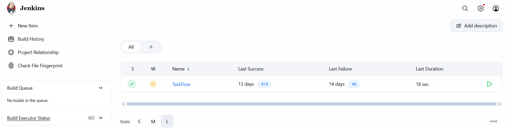
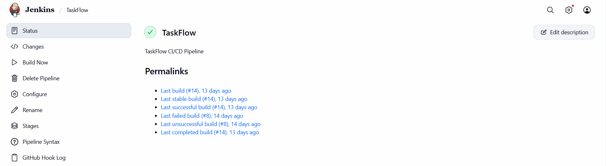
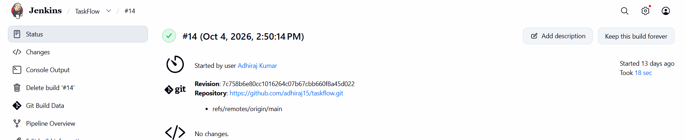
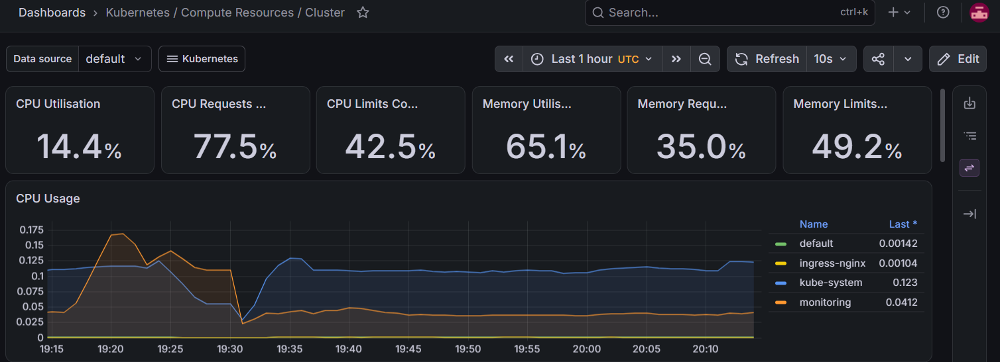
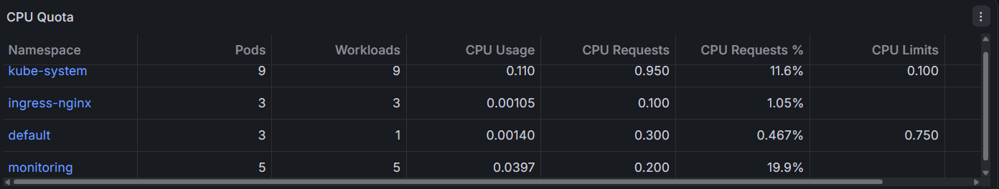

# TaskFlow — Project Screenshots

Visual evidence of the TaskFlow DevOps project, arranged in implementation order.

## 1. CI/CD Pipeline — Jenkins

### Jenkins Dashboard

### TaskFlow Pipeline Job

### Successful Pipeline Build — #14

Build #14 completed successfully. The pipeline checked out code from GitHub, built the Docker image, ran the TaskFlow container, and passed the application health check.

## 2. Monitoring — Prometheus & Grafana

### Kubernetes Cluster Overview

### Namespace Resource Usage

